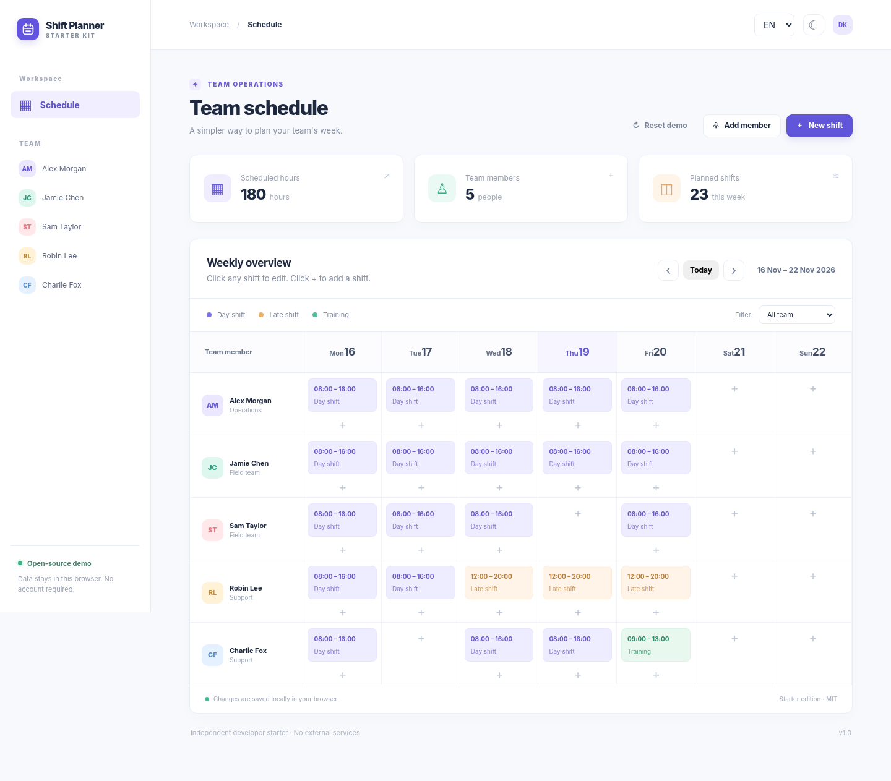

# Shift Planner Starter

> Open-source weekly employee scheduling starter with a polished dashboard, shift editor, team roster, and persistent browser demo. **Independent project. No SaaS, VOLENG, or third-party accounts required.**



[Mobile preview](assets/shift-planner-mobile-preview.png)

**Live demo:** https://engconsulting.be/shift-planner/shift-planner/ (hosted demo; browser-only data).

## Version 1.1 — shared hosting fix

The browser application now loads `public/app.js` as a regular script, avoiding `.mjs` MIME-type issues on some static hosts. The demo uses **vanilla JavaScript**; `react/` is an optional integration example, **not** a complete React component library.

## Features

- Weekly schedule with previous/next week and Today navigation
- Add and edit same-day shifts and team members; delete shifts
- Three example shift categories: Day, Late, Training
- 15-minute time selection validation
- Team filter, weekly KPI cards, example data and Reset
- English, French and Dutch UI; light and dark themes
- Local browser persistence via `localStorage` (no backend, no external calls)
- Zero runtime dependencies; Node.js 20+ static server; simple `/health` endpoint
- MIT licensed; safely reusable in your own work

## Start

```bash
npm start
```

Open **http://127.0.0.1:4309**. Or double-click `START_DEMO_WINDOWS.cmd` on Windows with Node.js 20+ installed.

```bash
npm test
npm run check
```

## Hostinger / server deployment

If your hosting package supports Node.js web apps, upload/import this repository, choose Node.js 20+ and configure:

- **Start command**: `npm start`
- **Port**: use the port provided by your host (`process.env.PORT` is supported)
- **Health check**: `/health`
- **No database, credentials, or environment file required**

Actual available deployment options depend on your hosting plan. This repository **does not contain a Hostinger referral or one-click deploy button**. Add an authorized referral button only after your partner application and target deployment are approved.

## Project structure

```
public/index.html      Accessible demo UI
public/styles.css      Styles / light and dark themes
public/app.js          Browser UI and local state (shared-host compatible)
src/schedule.mjs       Framework-independent scheduling utilities
server.mjs            Node.js static HTTP server
react/ShiftPlanner.jsx Optional React integration component
react/README.md       React example integration notes
```

### React integration

The running demo uses **dependency-free JavaScript** so users can try it instantly. A small **optional React example component** is provided under `react/`. To use it, add React/ReactDOM to your own React project and import scheduling utilities from `src/schedule.mjs`. **The full dashboard is not yet a React component library.**

## Limitations (important)

This is a **starter/demo**, not a production multi-tenant workforce platform. It has no authentication, shared database, email, permission system, drag-and-drop, leave approval or payroll integrations. Data is stored in the browser where it runs. Browser storage may be cleared. Shifts cannot span midnight. This project does **not** implement official government check-in reporting or attendance compliance.

Do not enter sensitive employee information in the public demo. Review third-party integration, security, accessibility and your own legal/compliance requirements before production use.

## License

MIT — see `LICENSE`. Example employees are fictional. No third-party assets or brand marks are bundled.

## Publish as a static demo (no Node hosting needed)

Upload the **contents** of `public/` (`index.html`, `styles.css`, `app.js`) to a dedicated folder such as `/shift-planner/` on an existing static host. No database or `.env` file is required. Keep the folder separate from your main website.

For a Node.js app host, upload this repository and run `npm start`; its included static server serves the same files at `/`.

## License and limits

MIT license for this Starter only. It stores demo changes in the current browser (`localStorage`) and is **not** a multi-user HR, payroll, or attendance product. No paid Pro implementation is included.
